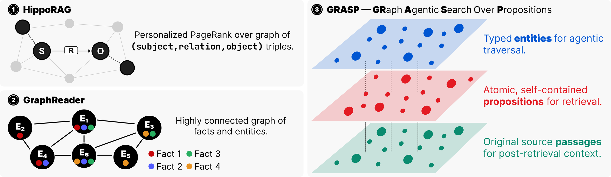
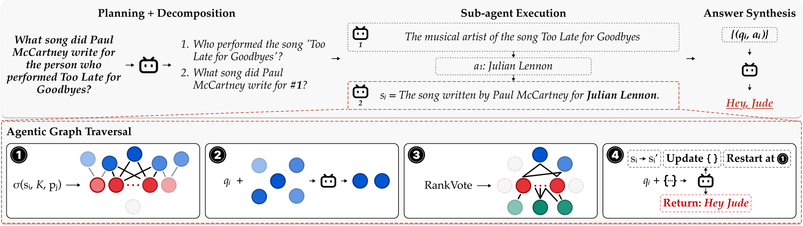

# GRASP: Graph Agentic Search over Propositions

Code for *GRASP: Graph Agentic Search over Propositions for Multi-hop Question Answering*,
by J. Stockton Jenkins, Ramya Korlakai Vinayak and Junjie Hu (University of Wisconsin–Madison),
accepted at **EACL 2027**.

GRASP indexes a corpus as a three-layer graph (entities → propositions → passages), plans a
multi-hop question into dependency-ordered sub-questions, and resolves each with a sub-agent
that traverses the graph before a final synthesis step.





```
grasp/
  agent/      planner + rewriter, sub-agent, candidate validator, synthesis, orchestrator
  graph/      Neo4j storage, hybrid retrieval (Eq. 1) and RankVote (Eq. 2)
  indexing/   joint proposition/entity extraction (Fig. 3) and graph construction
  eval/       metrics, runner, LLM judge, success economy (Eq. 3), Table 2 recall
  baselines/  Table 6 baselines and their dense passage index
  prompts/    every prompt sent to the model
configs/      one file per reported result
```

## Setup

```bash
uv sync
export GOOGLE_API_KEY=...            # Gemini runs, the judge, and difficulty estimation
```

**Neo4j.** Download the [Neo4j 5.26 community tarball](https://neo4j.com/deployment-center/)
and a JDK 17, then point GRASP at the unpacked directory. Each command starts a local
server on the config's `neo4j_dir` and stops it when done; APOC ships in the tarball and is
enabled automatically.

```bash
tar xzf neo4j-community-5.26.6-unix.tar.gz
export NEO4J_HOME=$PWD/neo4j-community-5.26.6
```

To use a server you already run instead, set `NEO4J_URI` (and `NEO4J_USERNAME`/`NEO4J_PASSWORD`).

**Data.** The retrieval-setting data is included:

- `data/{musique,2wiki,hotpot}/`: `qa.json` (1,000 questions) and `corpus.json` for each dataset.
  These are the [HippoRAG 2](https://github.com/OSU-NLP-Group/HippoRAG) retrieval splits of MuSiQue (CC BY 4.0), 2WikiMultihopQA
  (Apache 2.0) and HotpotQA (CC BY-SA 4.0), which keep their original licenses.
- `data/musique/rewritten_subquestions.json`: the rewritten gold sub-questions used for Table 2.
- `data/difficulty/`: per-question difficulty estimates `r_i` for both backbones.

The LongBench variants download from Hugging Face on first use.

**Qwen3-32B.** Serve it with vLLM's tool-call parser so structured output works, and
embed with `BAAI/bge-large-en-v1.5` locally (configured in `configs/paper/qwen/`):

```bash
vllm serve Qwen/Qwen3-32B --tensor-parallel-size 2 --max-model-len 32768 \
    --enable-auto-tool-choice --tool-call-parser hermes
export VLLM_BASE_URL=http://localhost:8000/v1
```

## Reproducing the paper

Each `configs/paper/<model>/<dataset>.yaml` is one Table 1 cell. `grasp run` builds the graph,
then answers every question; `grasp cw` reports success economy with a 95% bootstrap CI.

```bash
uv run grasp run configs/paper/gemini/musique.yaml          # -> results/paper/gemini/musique.json
uv run grasp cw  results/paper/gemini/musique.json --difficulty data/difficulty/musique/gemini.json
```

Runs are resumable: re-running skips indexed passages and answered questions, and retries
errors. Token totals include graph construction. Add `--limit 10` for a quick check.

| Result | Commands |
| --- | --- |
| Table 2 (passage recall) | `grasp index` a config (`configs/paper/gemini/musique.yaml` for propositions, `configs/recall/musique_sentences.yaml` for sentences), then `grasp recall CONFIG --rewritten data/musique/rewritten_subquestions.json [--mode single] [--scoring count]` |
| Figure 5 (structural ablations) | `grasp run` each `configs/ablations/*.yaml` |
| Table 6 (non-agentic baselines) | `grasp dense-index --dataset musique --data data/musique --out data/dense/musique` for Self-Ask, plus `--corpus --out data/dense/musique-corpus` for RAG and Q-Dec, then `grasp eval configs/baselines/...` and `grasp judge results/...` |
| Difficulty weights `r_i` | `grasp difficulty --dataset musique --data data/musique --out data/difficulty/musique/gemini.json` |

## Citation

```bibtex
@inproceedings{jenkins2027grasp,
  title     = {{GRASP}: Graph Agentic Search over Propositions for Multi-hop Question Answering},
  author    = {Jenkins, J. Stockton and Korlakai Vinayak, Ramya and Hu, Junjie},
  booktitle = {Proceedings of the 2027 Conference of the European Chapter of the Association for Computational Linguistics (EACL)},
  year      = {2027}
}
```

## License

The code is released under the MIT License (see `LICENSE`). The bundled datasets keep their original licenses, listed under **Data** above.
